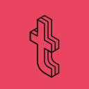

<p align="center">
  
</p>

<h1 align="center">terraLauncher</h1>

<p align="center">One place to install, update and open the terraPen apps, with links to the web apps and hardware.</p>

> [!IMPORTANT]
> Early work in progress. It builds and runs on Windows from source; there are no installers or
> releases yet. See [Status](#status).

## What it shows

**Apps** — installed, updated and opened from the launcher, using each app's GitHub releases.

| App | What it's for | Source |
|---|---|---|
| **terraGen** | Generative plotter art | [shaboomi/terraGen](https://github.com/shaboomi/terraGen) |
| **terraForge** | Plotter control and G-code generator | [theworkisthework/terraForge](https://github.com/theworkisthework/terraForge) |

**Web apps** — opened in your browser.

| App | What it's for | Link |
|---|---|---|
| **terraLens** | Camera to plotter line art | [plotterlens.terrapen.xyz](https://plotterlens.terrapen.xyz/) |

**Products** — opened in your browser.

| Product | What it is | Link |
|---|---|---|
| **terraPen** | Open-source A2 pen plotter | [terrapen.xyz](https://terrapen.xyz/products/terrapen-s-a2-pen-plotter) |
| **terraDial** | Touchscreen dial for FluidNC plotters | [terrapen.xyz](https://terrapen.xyz/products/terradial) |

## How installs work

The launcher asks GitHub for each app's newest release, picks the file for your system, checks it
against the release's SHA-256 (`SHA256SUMS.txt`, or the digest GitHub records for the file), and
then runs it.

| System | Package | Notes |
|---|---|---|
| Windows | The app's setup program (`…-setup.exe`, `….Setup.<version>.exe`) | Run with the switches in the catalog (`setup_args`) so it shows at most a progress window. Installed copies are found by their uninstall record. |
| macOS | `.dmg` | Only for apps with a `mac_team` in the catalog (the Apple Developer team that signs the build). Neither app has one recorded yet, so on macOS the launcher opens a copy that is already installed but installs nothing. |
| Linux | `.AppImage`, `.deb` | Not tested yet. |

## Changing the catalog

- Apps: [`crates/core/catalog.toml`](crates/core/catalog.toml). The comments at the top explain each field.
  A new app also needs a 128 px icon in `assets/app-icons/<id>.png` and a line in `app_icon_png`
  in [`crates/core/src/catalog.rs`](crates/core/src/catalog.rs).
- Web apps and products: `WEB_APPS` and `PRODUCTS` in [`crates/core/src/catalog.rs`](crates/core/src/catalog.rs).

## Build from source

You need a recent stable Rust.

```sh
cargo run -p artcraft-launcher            # the desktop app (binary: terralauncher)
cargo test -p artcraft-launcher-core      # core tests
```

The crates keep their upstream package names (`artcraft-launcher-*`) so changes can still be
merged from upstream; only the binary and everything a user sees are renamed.

## Status

Working, checked on Windows 11:

- Lists terraGen and terraForge, finds installed copies and their versions, and offers updates.
- Updating terraForge from the launcher.
- Web apps and Products sections, opening in the browser.
- No connection to ArtCraft's servers: the hosted catalog, release feed and launcher self-update are off.

Not done yet:

- **Only updating has been run end to end**: terraForge 1.5.1-pen-preview.1 to 1.5.1 on Windows 11
  (download, checksum, silent install, re-detection). A fresh install, uninstall and the Open
  button have not been run yet, and nothing has been run for terraGen.
- **terraGen's repository is private.** Without a public repo the launcher can't see or download its
  releases; it only shows the installed copy.
- macOS installs need each app's Apple Developer team ID in the catalog.
- The launcher's own installers and CI (`packaging/`) are still upstream's and have not been adapted.
- Most of the upstream test suite still refers to the Craft apps and fails or needs rewriting.
- New interface text is English only; the 14 translation catalogs have not been updated for it.
- The app icon is a placeholder.

## Credits and license

terraLauncher is a fork of [ArtCraft Launcher](https://github.com/storytold/craft-launcher) by the
ArtCraft Team and its contributors, used under its MIT / Apache-2.0 license. It is not affiliated
with or endorsed by ArtCraft. The ArtCraft name, logo and marks are not part of that license and
have been removed from this fork.

Dual-licensed under [MIT](LICENSE-MIT) or [Apache-2.0](LICENSE-APACHE), at your option. Required
notices are in [NOTICE](NOTICE); bundled fonts and icons are listed in [ATTRIBUTION.md](ATTRIBUTION.md).
